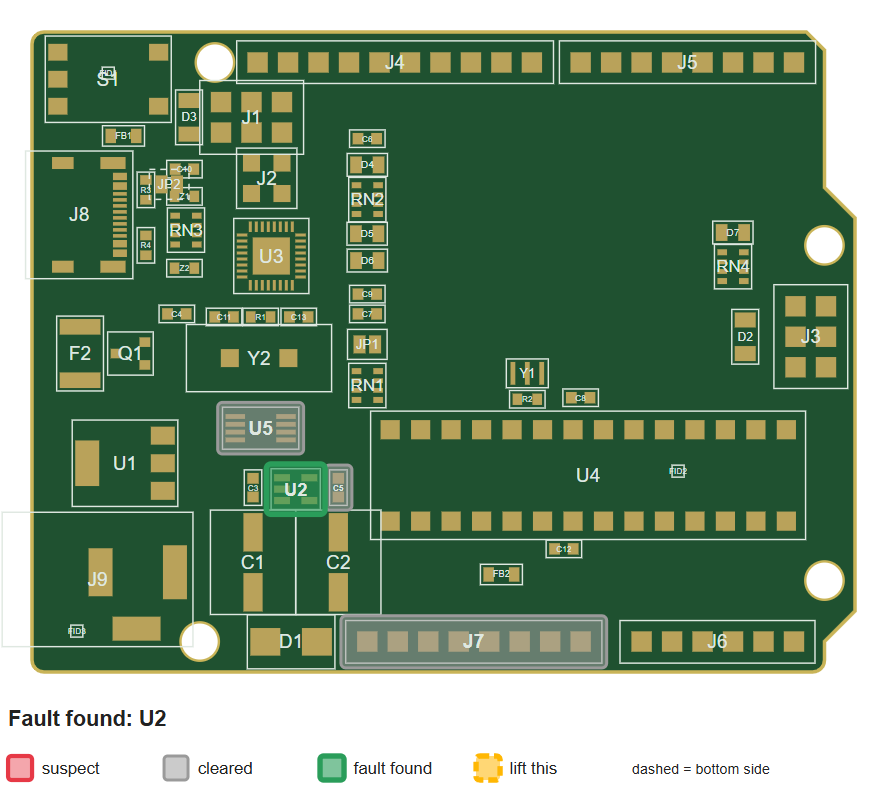

# Wrench Board Lite

A Python tool that reads a KiCad schematic, takes a symptom like "the 5 V rail is dead," and guides a step by step diagnosis: which parts to suspect, what to measure next, and where to put the probe on the board. Every part and net it names comes from the schematic itself.



## What it does

```text
> python -m wrenchboard session +5V dead --source usb --svg board.svg
Suspects: Q1, U5, F2
Measure the voltage on USBVCC (expected about 5 V): 5
  as expected. Cleared: F2. Remaining: Q1, U5
Measure the voltage on GATE_CMD (expected about 0 V): 0
  as expected. Cleared: U5. Remaining: Q1
Fault found: Q1
```

With `--svg`, it also draws the board and updates the picture after every reading: suspects in red, cleared parts in gray, the fault in green, and blue dots on the exact pads to measure.

## Setup (Windows)

Requires Python 3.10 or newer and KiCad 8 or newer (KiCad is only needed to export the netlist).

```bat
git clone https://github.com/Rowninator/wrenchboard.git
cd wrenchboard
py -m venv .venv
.venv\Scripts\activate
python -m pip install pytest anthropic
python -m pytest -q
```

On Linux or macOS, use `python3 -m venv .venv` and `source .venv/bin/activate`.

The exported netlist is committed, so the tests run without KiCad. To regenerate it after changing the schematic, run `python scripts\export_netlist.py`.

## Commands

| Command | What it does |
| --- | --- |
| `python -m wrenchboard diagnose +5V dead --source barrel` | Ranks suspect parts, with a reason for each |
| `python -m wrenchboard session +5V dead --source usb` | Asks for one reading at a time until one part remains |
| `python -m wrenchboard session +3.3V shorted` | Asks you to lift one suspect at a time and remeasure |
| `... --svg board.svg` | Writes a picture of the board with highlights |
| `... --replay tests\fixtures\uno_scenarios.json --scenario "Q1 stuck open"` | Runs a session from recorded readings |
| `python -m wrenchboard ask "nothing turns on when I plug in USB"` | Optional AI layer: describe the problem in your own words |

Symptoms are `dead` (no voltage) and `shorted` (near zero ohms to ground). A dead rail needs the active power source: `usb` or `barrel` on the Uno.

## How it works

1. **Graph** (`graph.py`). KiCad exports the schematic as an XML netlist, which already resolves wires, labels, and hierarchical sheets. The parser turns it into parts, pins, and nets, and tracks which parts are unpopulated.
2. **Board config** (`boards/uno_r3/board.json`). Facts read from the schematic by hand: the ground net, each power source's connector and supply net, and the voltage each power net should show. Every name is checked against the graph on load.
3. **Diagnosis** (`diagnosis.py`). For a dead rail, it walks backward from the rail toward the active source through regulators, switches, and series parts, keeping only paths that reach the source. For a switch, the part driving its control input is also a suspect. For a short, every part with a pin on both the rail and ground is a suspect, capacitors first.
4. **Session** (`session.py`). Picks the measurement that splits the remaining suspects most evenly. A good reading at a net clears everything upstream of it; a bad one clears everything downstream. Every step is chosen so either result removes at least one suspect, so there are no dead end steps.
5. **PCB and drawing** (`pcb.py`, `render.py`). Reads part positions and pads from the `.kicad_pcb` file, cross checks every part and pad net against the schematic, and draws the board from that same data, so a highlight can only land on the part it names.
6. **AI layer** (`ai.py`, optional). Uses Claude Haiku 4.5 for two narrow jobs: turning a description into a rail, symptom, and source by filling in a form whose choices come from the board, and explaining the engine's results in plain language. It never chooses suspects, and any explanation that names a part outside the suspect list is discarded. Needs the `ANTHROPIC_API_KEY` environment variable; everything else works without it.

## Accuracy

The engine cannot invent a part or net. Names come only from the graph, and a final check rejects any output naming something that isn't in it. The tests confirm this on every rail, symptom, and source combination of the real board.

## Assumptions and limits

1. **One fault at a time.** A single reading can rule parts out only under this assumption.
2. **Expected voltages are hand derived.** The Uno config assumes a 9 V adapter and about 0.7 V across the input diode. A reading counts as good within 10% or 0.3 V of expected.
3. **Readings in the tests are simulated.** There is no physical board; each fault is a scenario file listing the readings a real board would show.
4. **Pin types are trusted.** The walk relies on KiCad marking regulator pins as power input and output and switch gates as inputs. This holds for the Uno, and the fault tests guard it.
5. **A short is fixed at 10 ohms.** A partly failed part above that would read as "short gone."
6. **One board.** The design is generic, but only the Uno R3 has a config and tests.

## Tests

```bat
python -m pytest -q
```

171 tests cover the parser, config validation, diagnosis rules, the measurement loop, PCB reading, drawing, the command line, and the AI layer (with a fake client, so no API calls). The Uno tests include 10 nets checked by hand against the schematic, three faults diagnosed and found with no dead end steps, and highlights landing on the right parts. One live API test runs only with `WRENCHBOARD_LIVE=1` set.

## Project layout

```text
wrenchboard/        graph, board, diagnosis, session, pcb, render, ai, command line
tests/              tests and fixtures (hand made netlists, PCB, scenarios)
boards/uno_r3/      KiCad files, exported netlist, board.json
scripts/            netlist export and a net inspection helper
docs/               spec and images
```

## Credits

The Uno R3 design files come from [KiCad Arduino Boards](https://github.com/sabogalc/KiCad-Arduino-Boards), a KiCad recreation of the Arduino boards. See that repository for its license.
